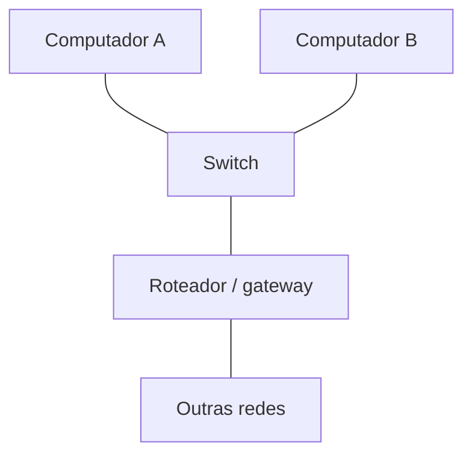

# Redes: endereço IP, gateway e DNS

[Voltar ao índice](../README.md)

**Público:** iniciantes · **Duração:** 2 aulas de 50 minutos.

## Objetivos e pré-requisitos

Distinguir endereço IP, máscara, gateway e DNS; calcular uma rede /24 e formular hipóteses de diagnóstico. Use o cenário fictício abaixo e um computador conectado à rede do laboratório. Os testes devem ocorrer apenas no ambiente autorizado para a aula.

## Explicação para a aula

> “O endereço IP identifica uma interface na rede. A máscara ajuda a determinar quais destinos estão na mesma sub-rede. O gateway é usado para alcançar outras redes. O DNS associa nomes a registros, como os endereços usados para acessar serviços.”

## Cenário de laboratório

| Equipamento | Endereço IPv4 | Máscara | Gateway |
| --- | --- | --- | --- |
| Computador A | 192.168.10.20 | 255.255.255.0 (/24) | 192.168.10.1 |
| Computador B | 192.168.10.30 | 255.255.255.0 (/24) | 192.168.10.1 |
| Roteador, interface da LAN | 192.168.10.1 | 255.255.255.0 (/24) | — |

Os endereços são exemplos. Não altere a configuração da rede real para reproduzir a tabela; faça essa etapa em um simulador ou ambiente isolado preparado pelo professor.

## Prática guiada de observação

| Pergunta | Linux | Windows |
| --- | --- | --- |
| Qual é a configuração da interface? | `ip address` | `ipconfig` |
| Qual é a rota padrão? | `ip route` | `ipconfig` mostra o gateway |
| Consigo alcançar o gateway? | `ping -c 4 ENDERECO_DO_GATEWAY` | `ping -n 4 ENDERECO_DO_GATEWAY` |
| Como o nome é resolvido? | `nslookup example.com`, se instalado | `nslookup example.com` |

Substitua `ENDERECO_DO_GATEWAY` pelo endereço observado no seu ambiente. Algumas distribuições exigem ferramentas adicionais para executar `nslookup`; se não estiver disponível, use a demonstração do professor. Registre observação, hipótese e próximo teste.

**Interpretação:** resposta ao ping indica conectividade ICMP naquele teste. Falha não prova indisponibilidade: ICMP pode ser bloqueado. Uma resposta DNS também não garante que o serviço web esteja acessível.

## Desafios e entrega

1. No cenário, A e B pertencem à mesma sub-rede?
2. Identifique endereço da rede, broadcast e faixa convencional de hosts dessa /24.
3. Um computador alcança o gateway, mas não resolve nomes. Qual hipótese deve ser investigada?
4. Um nome resolve, mas a página não abre. Por que ainda precisamos testar o serviço?
5. Explique a diferença entre switch e roteador no diagrama.

Entregue uma tabela com três observações, hipóteses e testes. Para publicação, use os endereços fictícios do cenário em vez de informações da rede da escola.

Resolução comentada

1. Sim. Com /24, os dois endereços pertencem à rede 192.168.10.0/24.
2. Rede: 192.168.10.0; broadcast: 192.168.10.255; hosts convencionais: 192.168.10.1 a 192.168.10.254.
3. Investigue configuração e alcance do resolvedor DNS. O fato de alcançar o gateway não confirma conectividade completa com a internet.
4. DNS e acesso ao serviço são etapas distintas: o servidor web pode estar indisponível ou o tráfego pode ser filtrado.
5. Neste cenário, o switch conecta os dispositivos da LAN; o roteador encaminha pacotes entre redes.

## Avaliação formativa

Valorize a relação entre evidência e hipótese. Não atribua nota apenas por obter resposta ao ping: peça que o estudante explique os limites do teste. Consulte a [rubrica docente](../GUIA-DOCENTE.md).
